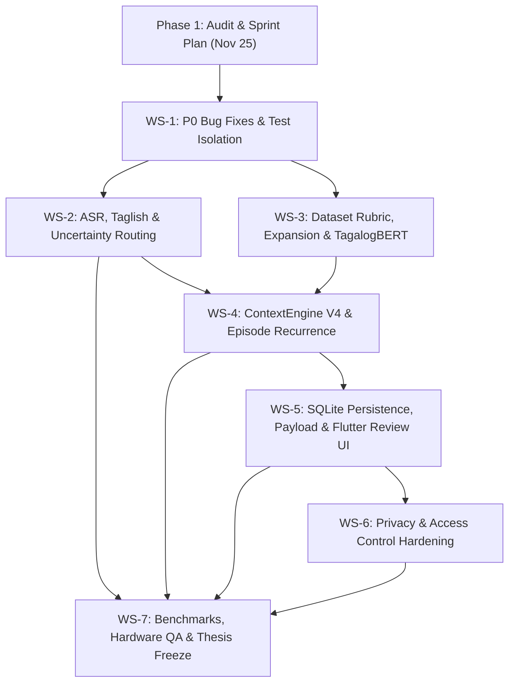

# SecureLink V4 — Sprint Plan (Nov 25 – Dec 30, 2026)

**Thesis Title:** SecureLink: Design and Development of a Compact NLP-Enabled Anti-Bullying Discreet Wearable Smart Badge Using Seeed Studio XIAO ESP32S3 Sense  
**Development Branch:** `SecureLink-DetectionV4` (based on protected `USBConnectionVersion` @ `dc14709`)  
**Protected Baseline:** `USBConnectionVersion` — **NEVER** commit, merge, reset, rebase, or force-push into this branch.  
**Implementation Deadline:** **December 30, 2026** (35 calendar days from November 25, 2026)  
**Scope Boundary:** Verbal bullying detection over the verified USB-only pipeline (audio acquisition -> USB transport -> preprocessing -> Faster-Whisper -> TagalogBERT + ContextEngine V4 -> SQLite persistence -> Flutter dashboard & human review). **Excludes** BLE, Wi-Fi pin transport, pulse sensing, and physical bullying detection.

---

## 1. Prioritized Workstreams

| Priority | ID | Workstream | Primary Files | Goal |
|---|---|---|---|---|
| **P0** | **WS-1** | Critical Reliability & Safety Defect Fixes | `server.py`, `usb_manager.py` | Eliminate USB `DANGER` crash (`send_line`), fix `PROMPT_ECHO_WORDS` false rejections, fix `audio_analyzing` state race, restore test isolation. |
| **P0** | **WS-2** | Transcription Quality, Taglish & Uncertainty Routing | `server.py`, `nsnet2.py` | Fix dead language fallback, evaluate Taglish ASR settings & temperature fallback, route `UNCERTAIN_TRANSCRIPTION` to human review instead of discarding. |
| **P1** | **WS-3** | Filipino Context, Dataset Expansion & TagalogBERT Integration | `dataset.csv`, `train.py`, `context_engine.py`, `server.py` | Build rubric-grounded Filipino/Taglish dataset (including ambiguous banter vs. harassment like `"Hoy, bakla ka!"` and adversarial `"joke lang"` + threat), train & evaluate TagalogBERT with stratified splits, actively integrate BERT probabilities into ContextEngine V4. |
| **P1** | **WS-4** | ContextEngine V4 Compositional Scoring & Episode Recurrence | `context_engine.py` | Eliminate premature early-return suppression, add explicit `AMBIGUOUS / NEEDS_REVIEW` state, align severity rubric with documented justification, distinguish split-stream utterances from multi-episode recurrence. |
| **P2** | **WS-5** | Incident Persistence, Metadata Propagation & Human-in-the-Loop UI | `server.py`, `lib/main.dart`, `lib/mobile/` | Add SQLite incident & review store, propagate full `SeverityAssessment` + ASR metrics over `/ui` and `/mobile`, add uncertainty badges, explanation drawer, and reviewer feedback actions in Flutter. |
| **P2** | **WS-6** | Privacy, Access Control & Secret Hygiene | `server.py`, `checkpoints.json` (template), docs | Protect `/recordings`, `/ui`, and admin routes (localhost default / token auth), sanitize tracked secrets, document retention & consent controls for thesis ethics defense. |
| **P3** | **WS-7** | End-to-End Verification, Hardware Testing & Thesis Artifacts | `tests/`, `securelinkdb/tests/`, eval reports | Execute full automated regression suite, controlled audio benchmark, real XIAO ESP32-S3 USB hardware checks, and freeze reproducible evaluation tables before Dec 30. |

---

## 2. Workstream Dependencies



---

## 3. Daily Implementation Milestones (Nov 25 – Dec 30, 2026)

### Week 1 — Foundation, P0 Fixes & Evaluation Rubric (Nov 25 – Dec 1)
| Date | Day | Milestone | Deliverables / Concrete Tasks | Checkpoint |
|---|---|---|---|---|
| **Nov 25** | 1 | **Phase 1 Complete** | `DETECTION_ARCHITECTURE_AUDIT.md`, `SPRINT_PLAN.md`, branch `SecureLink-DetectionV4` verified. Await user review/approval before Phase 2. | `CP-01` (Audit & Plan) |
| **Nov 26** | 2 | **WS-1: Fix P0 Crashes & Test Isolation** | Fix `usb_mgr.send_line` -> public `send_line()` wrapper in `usb_manager.py` (with regression test); fix `audio_analyzing` race; isolate `tests/test_ble_pairing_backend.py`, `tests/test_mobile_pairing_and_tunnel.py`, and `securelinkdb/tests/test_pin_provisioning_and_registration.py` (`ACTIVE_PAIRING_CODES_FILE`) from live JSON files; reconcile stale pairing test assertions. | — |
| **Nov 27** | 3 | **WS-1: Fix ASR False Rejections** | Disable `PROMPT_ECHO_WORDS` when `INITIAL_TAGALOG_PROMPT == ""`; refine token-concentration/repetition guardrails so panicked speech (`"Tulong tulong tulong po"`) is not dropped; add unit tests. | `CP-02` (P0 Stable) |
| **Nov 28** | 4 | **WS-2: Uncertainty Pipeline Contract** | Route `UNCERTAIN_TRANSCRIPTION` in `server.py:2648` into `context_engine.evaluate()` (strictly capped `< 8.0`, `human_review_required=True`, no `DANGER` trigger); update conflicting assertion in `tests/test_transcription_reliability.py`; save reviewable WAV metadata. | — |
| **Nov 29** | 5 | **WS-2: Controlled Audio Fixture Corpus** | Assemble/record non-sensitive controlled WAV test fixtures (clean Tagalog, Taglish, English, quiet speech, fan noise, silence, burst noise) in a dedicated test fixtures folder so `test_transcription_reliability.py` stops skipping 7/13 tests. | — |
| **Nov 30** | 6 | **WS-2: ASR & Filter Tuning Benchmark** | Benchmark `language="tl"` vs `language=None` (with Tagalog/English routing), `temperature=[0.0, 0.2, 0.4]`, `min_speech_duration_ms` (e.g. 150 vs 250 ms), and single vs cascaded HPF against the WAV corpus; document measured WER/CER & latency. | `CP-03` (ASR Tuned) |
| **Dec 1** | 7 | **WS-3: Annotation & Severity Rubric** | Author formal Filipino verbal-bullying annotation guidelines and severity rubric (distinguishing banter/teasing, identity-sensitive ambiguous utterances like `"Hoy, bakla ka!"`, verbal harassment, coercion, extortion, indirect intimidation, direct physical threats, and reported/past incidents). | — |

### Week 2 — Dataset Expansion & TagalogBERT Training (Dec 2 – Dec 8)
| Date | Day | Milestone | Deliverables / Concrete Tasks | Checkpoint |
|---|---|---|---|---|
| **Dec 2** | 8 | **WS-3: Dataset Expansion (Batch 1)** | Expand `dataset.csv` with balanced Tagalog/English/Taglish school-context examples: benign conversation, friendly peer banter/teasing (including identity terms in benign contexts), and clear verbal harassment. | — |
| **Dec 3** | 9 | **WS-3: Dataset Expansion (Batch 2)** | Add extortion, coercion/secrecy, indirect school intimidation, direct physical threats, adversarial `"joke lang"` + threat/extortion pairs, reported speech, and past incidents. Target **600–1,000+ curated, deduplicated examples** (or documented size with class balance). | — |
| **Dec 4** | 10 | **WS-3: Dataset Audit & Stratified Split** | Run dataset quality checks (duplicate detection, label consistency, class balance, explicit train/val/test stratified split with zero leakage — hold out an untouched test set including Filipino context edge cases). | `CP-04` (Dataset Frozen) |
| **Dec 5** | 11 | **WS-3: Upgrade `train.py` & Evaluation** | Update `train.py` for stratified splits, macro/per-class Precision/Recall/F1, confusion matrix, probability calibration (temperature scaling / ECE check), and deterministic seeds. | — |
| **Dec 6** | 12 | **WS-3: Fine-Tune & Validate TagalogBERT** | Train candidate `jcblaise/roberta-tagalog-base` model on RTX 3050; log real train/val/test metrics, per-class error analysis, and VRAM/latency profile. | — |
| **Dec 7** | 13 | **WS-3: Error Analysis & Model Hardening** | Inspect misclassifications on held-out validation set (especially Taglish, slurs-as-banter, and humor-masked threats); refine training hyperparameters or class weights if justified; freeze model checkpoint. | `CP-05` (Model Validated) |
| **Dec 8** | 14 | **Buffer / Mid-Sprint Review** | Run full Python test suites; verify VRAM footprint of Whisper + NSNet2 + active TagalogBERT under `ai_inference_lock`; resolve any bottlenecks. | — |

### Week 3 — ContextEngine V4 & Episode Recurrence (Dec 9 – Dec 15)
| Date | Day | Milestone | Deliverables / Concrete Tasks | Checkpoint |
|---|---|---|---|---|
| **Dec 9** | 15 | **WS-4: Compositional Intent Architecture** | Refactor `ContextEngine.analyze_intent()` to extract **all** co-occurring signals (threat signals + modifier signals like humor/negation/past/reported/hypothetical) instead of first-match early-return suppression. | — |
| **Dec 10** | 16 | **WS-4: Active TagalogBERT Fusion** | Wire `self.bert_model` and `self.tokenizer` into `ContextEngine.evaluate()` with graceful fallback when `bert_model is None`; populate `ContextExtraction.model_confidence`, class probabilities, and semantic–rule agreement/disagreement flags. | — |
| **Dec 11** | 17 | **WS-4: Filipino Context & Uncertainty Band** | Implement contextual ambiguity handling (e.g., `"Hoy, bakla ka!"` without corroborating threat/recurrence -> `AMBIGUOUS_CONTEXT` / `NEEDS_REVIEW` with moderated score and `human_review_required=True`; `"Papatayin kita, joke lang"` -> never suppressed to `NORMAL`, retains threat + `human_review_required=True`). Fix word-boundary matching in `extract_context()`. | `CP-06` (Engine V4 Core) |
| **Dec 12** | 18 | **WS-4: Rubric-Aligned Severity Scoring** | Align severity scoring weights, bounds, and safety caps to the documented rubric; ensure non-physical/uncertain/reported/ambiguous events cannot trigger `DANGER` (`>= 8.0`), while credible physical threats still do. | — |
| **Dec 13** | 19 | **WS-4: Episode-Aware Recurrence Tracker** | Upgrade `DeviceIncidentTracker` to group contiguous split-stream utterances (e.g., within 20–30 s) into a single **episode** before counting cross-episode recurrence; fix `intimidation_count` conflation; support SQLite-backed cross-session recurrence summaries. | — |
| **Dec 14** | 20 | **WS-4: Adversarial & Regression Test Suite** | Write comprehensive `tests/test_context_engine_v4.py` covering all V3 backward-compatibility tests plus Filipino context scenarios (`"Hoy, bakla ka!"`, `"joke lang"` + threat, `"kanina"` + active threat, split-stream single episode vs. multi-episode recurrence, BERT active vs. fallback). | `CP-07` (Engine V4 Tested) |
| **Dec 15** | 21 | **WS-4: Documentation Sync** | Update `SEVERITY_SCORER_EXPLANATION.txt` (or replace with V4 spec) so documentation accurately matches production code. | — |

### Week 4 — Persistence, Dashboard Propagation & Privacy (Dec 16 – Dec 22)
| Date | Day | Milestone | Deliverables / Concrete Tasks | Checkpoint |
|---|---|---|---|---|
| **Dec 16** | 22 | **WS-5: SQLite Incident & Review Store** | Implement lightweight SQLite database (`securelinkdb/incidents.db`, gitignored) storing full `SeverityAssessment`, ASR metrics, audio path, unique collision-free UTC incident IDs, and reviewer disposition (`PENDING`, `CONFIRMED_BULLYING`, `BENIGN_BANTER`, `FALSE_POSITIVE`, `ESCALATED`). Add `GET /api/incidents` and `POST /api/incidents/{id}/review`. | — |
| **Dec 17** | 23 | **WS-5: Additive WebSocket & REST Payload** | Update `server.py` to stop tuple-unpacking `context_engine.evaluate()`, emit full contextual metadata + ASR confidence + `human_review_required` + `transcription_status` in `incident_payload` while preserving all legacy keys, and send recent incidents on `/ui` connect. | `CP-08` (Backend V4 Complete) |
| **Dec 18** | 24 | **WS-5: Flutter Desktop Incident Model & UI** | Update `Incident` model (`lib/main.dart`) with null-safe parsing for new fields; display intent, explanation, risk factors, confidence, `NEEDS HUMAN REVIEW` / `UNCERTAIN` badges, and reviewer disposition buttons in `_IncidentDetailCard`. | — |
| **Dec 19** | 25 | **WS-5: Structured Incident Export & Review Log** | Add structured CSV/JSON report export (with timestamps, explanation, confidence, and reviewer status) alongside existing clipboard export; update mobile `IncidentReport` model for backward-compatible display of new fields. | — |
| **Dec 20** | 26 | **WS-5: Flutter Verification & Build** | Run `flutter analyze` (verify 0 errors and no new warnings), build Windows release (`flutter build windows --release`), and test desktop UI end-to-end against live backend. | `CP-09` (Dashboard V4 Built) |
| **Dec 21** | 27 | **WS-6: Privacy & Access Control Hardening** | Default backend binding/access policy to localhost or require admin bearer token for `/ui`, `/recordings`, and admin REST endpoints (configurable via env var for controlled campus LAN demos); add optional privacy mode (store audio only for flagged/reviewable events when enabled); add disk cap alongside 30-day retention. | — |
| **Dec 22** | 28 | **WS-6: Secret Hygiene & Security Tests** | Remove plaintext Wi-Fi credentials from tracked `checkpoints.json` (use `.example` template + `.gitignore` for local state), document firmware NVS provisioning without hardcoded defaults, and add auth/access-control unit tests. | `CP-10` (Privacy Hardened) |

### Week 5 — Full Validation, Hardware Testing & Thesis Freeze (Dec 23 – Dec 30)
| Date | Day | Milestone | Deliverables / Concrete Tasks | Checkpoint |
|---|---|---|---|---|
| **Dec 23** | 29 | **WS-7: End-to-End Integration Testing** | Run full root `tests/` and `securelinkdb/tests/` suites; verify zero regressions in USB serial protocol, battery telemetry, backend lifecycle, and pairing tests. | — |
| **Dec 24** | 30 | **WS-7: Controlled Evaluation Benchmark** | Run locked held-out text evaluation set + controlled WAV audio test set through the complete V4 pipeline; generate reproducible metrics report (confusion matrix, per-class F1, false-positive rate on Filipino banter, recall on masked threats, inference latency, VRAM usage). | — |
| **Dec 25** | 31 | **Buffer / Holiday Flexibility** | Contingency buffer day for any unexpected debugging or model recalibration. | — |
| **Dec 26** | 32 | **WS-7: Physical Hardware USB Validation** | Test physical XIAO ESP32-S3 Sense on `COM4`: USB auth, heartbeat stability, unplug/replug, reconnect during/after audio, live spoken Tagalog/Taglish/English scenarios (benign, `"Hoy, bakla ka!"`, `"joke lang"` + threat, verbal harassment, physical threat), verify zero `DANGER` crashes and dashboard review workflow. | `CP-11` (Hardware Verified) |
| **Dec 27** | 33 | **WS-7: Bug Fixes from Hardware QA** | Resolve any latency, threshold, or UX defects discovered during physical hardware sessions; re-run full regression suites. | — |
| **Dec 28** | 34 | **WS-7: Release Build & Installer Verification** | Rebuild Windows Release runner (`flutter build windows --release`), verify backend startup and clean-state launch, run final `flutter analyze` and all automated Python suites. | — |
| **Dec 29** | 35 | **WS-7: Thesis Defense Evidence Package** | Compile final V4 Validation & Ablation Report (V3 regex-only vs. V4 hybrid BERT + ContextEngine, limitations statement, privacy & ethics safeguards, reproducible test logs). | `CP-12` (Release Candidate) |
| **Dec 30** | 36 | **DEADLINE — Final Freeze & Sign-Off** | Final verification of `SecureLink-DetectionV4` clean working tree, confirm `USBConnectionVersion` untouched at `dc14709`, present final report for user review and merge/push approval. | `CP-13` (V4 Final Freeze) |

---

## 4. Measurable Acceptance Criteria

All metrics below will be **measured empirically** during execution (no targets may be claimed met without recorded command/script output):

1. **WS-1 (P0 Stability):**
   * `DANGER` (`score >= 8.0`) over USB no longer raises `AttributeError`; WAV file is saved and `incident` event is broadcast to `/ui`.
   * `"Tara sa paaralan"` and `"Magandang umaga po"` are not rejected by `PROMPT_ECHO_WORDS` when `INITIAL_TAGALOG_PROMPT == ""`.
   * `python -m unittest discover -s tests -p "test_*.py"` and `python -m unittest discover -s securelinkdb/tests -t . -p "test_*.py"` pass with **0 failures, 0 errors**, and **0 mutations** to tracked JSON files.
2. **WS-2 (ASR & Uncertainty):**
   * `UNCERTAIN_TRANSCRIPTION` results reach `ContextEngine`, are persisted with `human_review_required=True`, appear in the dashboard review queue, and are strictly capped `< 8.0` (never triggering `DANGER`).
   * Benchmark script records actual WER/CER, rejection rate, and latency across Tagalog, English, Taglish, quiet speech, and noise WAV fixtures.
3. **WS-3 & WS-4 (Hybrid V4 Detection & Filipino Context):**
   * TagalogBERT executes active forward passes inside `ContextEngine.evaluate()` (verified by automated test asserting model call + probability propagation + graceful fallback when `bert_model=None`).
   * Held-out stratified test evaluation reports actual per-class Precision, Recall, F1, Macro-F1, and Confusion Matrix (V3 baseline vs. V4 hybrid ablation).
   * Context-sensitive test cases pass:
     * `"Hoy, bakla ka!"` (isolated, no hostile corroboration) -> flagged as context-uncertain / `human_review_required=True` (neither silently ignored at `1.0` nor auto-escalated to `DANGER`).
     * `"Papatayin kita mamaya sa gate, joke lang"` -> **not** suppressed to `NORMAL`; flagged for elevated threat + human review.
     * `"Kanina pa kita hinihintay, bubugbugin kita ngayon"` -> **not** downgraded to `PAST_INCIDENT`.
     * Single continuous episode split across two 8-second streams within 20 s -> grouped as 1 episode, not falsely escalated as multi-incident harassment.
4. **WS-5 (Persistence & Dashboard):**
   * Incidents survive `server.py` restart via SQLite and reload on `/ui` connect.
   * All 11 `SeverityAssessment` fields + ASR confidence fields appear in `GET /api/incidents` and WebSocket `incident` payloads while keeping all legacy keys intact.
   * Reviewer disposition update (`POST /api/incidents/{id}/review`) persists and updates UI state.
   * `flutter analyze` exits with **0 errors**, and `flutter build windows --release` succeeds.
5. **WS-6 (Privacy & Access Control):**
   * Unauthenticated requests to protected `/recordings/*`, `/ui`, or admin APIs are rejected when access control is enabled (verified by automated HTTP/WebSocket tests).
   * Zero plaintext Wi-Fi passwords in tracked config files.
6. **WS-7 (Physical Hardware):**
   * Documented physical XIAO ESP32-S3 Sense (`COM4`) run verifying auth, heartbeat, unplug/replug, reconnect during/after audio, live speech transcription, and `DANGER` handling without watchdog reboots.

---

## 5. Regression Prevention & Testing Requirements

### 5.1 Protected Baseline & Branch Discipline
* `USBConnectionVersion` (`dc14709`) is **read-only**. Never commit, merge, reset, rebase, or force-push into it.
* All V4 commits occur exclusively on `SecureLink-DetectionV4`.
* Do **not** push to `origin` without explicit user approval.

### 5.2 Backward-Compatibility Contracts
* Preserve `score, category = context_engine.evaluate(...)` tuple unpacking (`SeverityAssessment.__iter__`, `__getitem__`, `__len__`).
* Preserve all existing keys in `/ui`, `/mobile`, `/api/usb/*`, `/api/system/info`, and `/health` JSON payloads (strictly additive schema changes).
* Preserve USB serial framing (`SL:IDENT`, `SL:AUTH`, `SL:PING`, `SL:PONG`, `SL:STREAM_START`, `SL:AUDIO`, `SL:AUDIO:ACK`, `SL:STREAM_END`, `SL:VAD:*`).

### 5.3 Mandatory Verification Gates Before Every Checkpoint
1. **Targeted Python unit tests** for modified modules.
2. **Full Python suites** (`tests/` and `securelinkdb/tests/`) at every milestone checkpoint.
3. **`flutter analyze`** after every Dart edit, and **`flutter build windows --release`** after UI milestone completions.
4. **Clean-tree check** (`git status`) verifying tests did not modify tracked user state files.
5. **Physical USB hardware check** required whenever USB transport, `handle_completed_audio`, or firmware interaction changes.

---

## 6. Known Limitations (To Be Disclosed in Thesis & Defense)

1. **Verbal Bullying Scope Only:** System evaluates spoken verbal content; it does not detect physical bullying, nonverbal gestures, cyberbullying, or physiological stress.
2. **Single-Microphone Far-Field & No Diarization:** The single onboard PDM mic cannot isolate speaker identity in crowded rooms; transcripts may capture bystanders or misattribute speaker vs. victim without human audio review.
3. **Cultural & Pragmatic Nuance in Filipino/Taglish:** Phrases like `"Hoy, bakla ka!"` or `"Gago ka pre"` depend heavily on relationship, tone, and social history that text alone cannot definitively resolve; therefore SecureLink operates strictly as an **assistive triage and documentation tool** with mandatory human review, never an autonomous disciplinary judge.
4. **USB-Only Deployment in V4:** Current V4 sprint builds on the verified USB baseline (`USBConnectionVersion`); wireless BLE/Wi-Fi re-integration is deferred beyond this phase.
5. **Dataset Scale Constraints:** Even after V4 expansion, an academic thesis dataset cannot cover every Philippine regional dialect or emerging slang; hybrid semantic + contextual + human-review design mitigates but does not eliminate out-of-vocabulary risk.

---

## 7. Stable Git Checkpoints & Progress Tracker

| Checkpoint | Target Date | Scope | Status | Commit SHA |
|---|---|---|---|---|
| `CP-00` | Nov 25 | Verified `USBConnectionVersion` baseline -> created `SecureLink-DetectionV4` | **DONE** | `dc14709` |
| `CP-01` | Nov 25 | Phase 1: `DETECTION_ARCHITECTURE_AUDIT.md` & `SPRINT_PLAN.md` | **DONE** | *(working tree)* |
| `CP-01B` | Nov 25 | Task 2: Lightweight Evaluation Framework (`eval/`), sample fixtures, unit tests & V3 baseline report | **DONE** | *(working tree)* |
| `CP-01C` | Nov 25 | Task 3: 300-scenario synthetic contextual dev dataset (`eval/datasets/v4_dev_300.json`), validator & V3 300-scenario baseline | **DONE** | *(working tree)* |
| `CP-01D` | Nov 25 | Task 5: Day 1 independent verification (121 automated tests passed, 0 regressions, Day 2 WS-1 ready) | **DONE** | *(working tree)* |
| `CP-02` | Nov 27 | WS-1: P0 bug fixes (`send_line`, `PROMPT_ECHO_WORDS`, state race, test isolation) | Pending | — |
| `CP-03` | Nov 30 | WS-2: ASR/Taglish benchmark, temperature fallback & uncertainty routing | Blocked on labeled spoken WAVs | Task 4 below |
| `CP-04` | Dec 4 | WS-3: Rubric & expanded stratified Filipino/Taglish dataset frozen | Pending | — |
| `CP-05` | Dec 7 | WS-3: Fine-tuned TagalogBERT evaluated & calibrated on held-out test set | Pending | — |
| `CP-06` | Dec 11 | WS-4: Compositional ContextEngine V4 + active BERT fusion + Filipino context | Pending | — |
| `CP-07` | Dec 14 | WS-4: Episode-aware recurrence + full V4 adversarial regression suite | Pending | — |
| `CP-08` | Dec 17 | WS-5: SQLite persistence + rich assessment payload propagation | Pending | — |
| `CP-09` | Dec 20 | WS-5: Flutter desktop/mobile review UI + Windows release build | Pending | — |
| `CP-10` | Dec 22 | WS-6: Privacy, access control hardening & secret hygiene | Pending | — |
| `CP-11` | Dec 26 | WS-7: Physical XIAO ESP32-S3 USB hardware end-to-end validation | Pending | — |
| `CP-12` | Dec 29 | WS-7: Final benchmarks, ablation report & release candidate build | Pending | — |
| `CP-13` | Dec 30 | **DEADLINE:** Final freeze on `SecureLink-DetectionV4` ready for approval | Pending | — |

---

## 8. Task 2 Actual Results — V3 Evaluation Framework Baseline (Nov 25, 2026)

### Implemented Components
* `eval/schema.py` — Pydantic dataset schema (`EvalDataset`, `EvalScenario`, `TurnItem`, `SplitType`, `EvaluationMode`) with `dev`/`held_out` split-isolation verification.
* `eval/metrics.py` — Pure unit-tested metrics: WER, CER, critical-word & negation recognition errors, per-class/macro Precision/Recall/F1, confusion matrix, friendly-teasing FP, serious-threat FN, severity agreement/MAE, false DANGER, review-priority accuracy/precision/recall, and latency percentiles.
* `eval/runner.py` — Isolated evaluation runner (fresh `ContextEngine` per scenario; mocked `save_wav`, `broadcast_to_ui`, and WebSocket triggers so zero hardware/camera/UI side effects occur; accurate missing-fixture and unsupported-capability reporting).
* Sample fixtures: `eval/datasets/dev_sample.json` (13 scenarios), `eval/datasets/held_out_sample.json` (6 disjoint scenarios), and deterministic synthetic WAVs (`eval/fixtures/audio/silence_1s.wav`, `fan_hum_2s.wav`).
* Unit tests: `tests/test_eval_framework.py` (**10/10 passed in 0.052 s**).

### Measured V3 Baseline (`eval/reports/v3_baseline_report.md` & `.json`)
* **Scenarios:** 19 total | **18 evaluated** | **1 missing fixture** (`DEV-AUD-MISSING-001`, accurately reported) | 0 unsupported | 0 skipped.
* **Intent Classification (n=16):** Accuracy `0.6875`, Macro Precision `0.7375`, Macro Recall `0.7417`, Macro F1 `0.7146`.
* **Severity Level (n=17):** Exact Agreement `0.7059`, Range Agreement `0.7059`, MAE `1.4059`, False `DANGER` `0/14` (`0.0`).
* **Safety Slices:** Friendly-Teasing FP `1/2` (`0.50`: `DEV-TXT-003`), Serious-Threat FN `3/9` (`0.3333`: `DEV-TXT-004`, `DEV-TXT-009`, `HO-TXT-005`), Review-Priority Accuracy `0.7647` (Precision `0.8333`, Recall `0.625`).
* **ASR Clips (n=2 synthetic silence/fan-hum):** Mean WER `0.0`, Mean CER `0.0` (no spoken speech WAVs yet; real spoken fixtures to be added in Task 3 / WS-2).
* **Latency:** Text/Multi-turn mean `0.137 ms` (p95 `0.695 ms`); Audio/E2E mean `22.638 ms` (max `43.467 ms`).

### Reproduction Commands
```powershell
# 1. Run evaluation framework unit tests
python -m unittest discover -s tests -p "test_eval_framework.py" -v

# 2. Fast text + multi-turn evaluation (no Whisper/CUDA load)
python -m eval.runner --dataset eval/datasets/dev_sample.json --dataset eval/datasets/held_out_sample.json --skip-audio

# 3. Full evaluation including audio & isolated end-to-end report export
python -m eval.runner --dataset eval/datasets/dev_sample.json --dataset eval/datasets/held_out_sample.json --output-md eval/reports/v3_baseline_report.md --output-json eval/reports/v3_baseline_report.json
```

---

## 9. Task 3 Actual Results — Contextual Development Dataset (`v4_dev_300.json`, Nov 25, 2026)

### Implemented Components
* `eval/build_v4_dev_dataset.py` — Deterministic generator producing 300 schema-validated synthetic development scenarios (`split=dev`), all tagged `synthetic_provisional`, `category:<name>`, and `group:<family_id>` for leakage-safe grouping.
* `eval/validate_dataset.py` — Schema validator, exact/near-duplicate auditor (Jaccard >= 0.85), distribution summarizer, and held-out split-isolation verifier.
* `eval/datasets/v4_dev_300.json` — **300 scenarios** (270 single-turn `text`, 30 `multi_turn`; 286 unique paraphrase/contrast groups).
* `eval/reports/v3_dev300_baseline.md` & `.json` — V3 text + multi-turn baseline report on all 300 scenarios.

### Dataset Coverage & Integrity Audit
* **Exact 10-Category Distribution (n=300):** Ordinary conversation (`45`), Friendly teasing & mutual banter (`40`), Verbal harassment (`40`), Ambiguous expressions (`35`), Direct & indirect threats (`35`), Multi-turn conversations (`30`), Reported speech (`20`), Negations & hypotheticals (`20`), Sarcasm & idioms (`20`), Extortion & coercion (`15`).
* **Language Coverage:** Filipino/Tagalog (`tl`: `135`), Taglish (`taglish`: `104`), English (`en`: `61`).
* **Provisional & Review Tagging:** `300/300` tagged `synthetic_provisional`; `110/300` marked `expected_review_required=True` (including all 35 ambiguous expressions, humor-masked threats, reported/indirect threats, and discomfort-signal multi-turn cases); `44` friendly-teasing scenarios; `63` serious-threat scenarios.
* **Required Challenge Themes Included:** Contrasting `"Hoy, bakla ka!"` in benign, ambiguous, and harmful contexts (same `group:grp_bakla` family); serious threats followed by `"joke lang"` / `"biro lang"` / `"charot lang"` / `"just kidding"`; mixed benign + harmful clauses (testing V3 negation/past-tense early returns); requests to stop & expressions of discomfort; repeated harassment; quoted/reported threats; insufficient-context fragments; and plausible Whisper ASR errors (`sa sapakin`, `pa patayin`, `ambobo`, `bak la ka`, etc.).
* **Duplicate & Leakage Audit:** `exact_duplicates=0`, `near_duplicates (>=0.85)=0`, `held_out_isolation` vs `held_out_sample.json`: `overlapping_ids=0`, `overlapping_texts=0`.

### Measured V3 Text Baseline on `v4_dev_300.json`
* **Execution:** `300/300` evaluated, `0` missing, `0` unsupported, `0` skipped.
* **Intent Classification (n=300):** Accuracy `0.6400`, Macro Precision `0.6858`, Macro Recall `0.7038`, Macro F1 `0.6413`.
* **Severity Level (n=300):** Exact Agreement `0.6433`, Level Macro F1 `0.5357`, Provisional Severity Range Agreement `0.6567`, Severity MAE `1.4770`.
* **Safety Slices:**
  * Friendly-Teasing False Positives: `8/44` (`0.1818`).
  * Serious-Threat False Negatives: `20/63` (`0.3175` — heavily driven by `"joke lang"`/`"biro lang"`/`"charot lang"` suppression, mixed-clause negation/past-tense early returns, ASR split-word threats, and extortion/coercion gaps).
  * False `DANGER` Classifications: `2/275` (`0.0073`: `V4-DEV-MT-004`, `V4-DEV-REP-014`).
  * Review-Priority Accuracy: `0.7600` (Precision `0.8393`, Recall `0.4273`).
* **Latency:** Mean `0.084 ms`, p50 `0.080 ms`, p95 `0.147 ms`, max `1.111 ms`.

### Human-Review & Held-Out Requirements (Before Model Training / Thesis Claims)
1. **Provisional Labels Only:** All 300 scenarios in `v4_dev_300.json` are `synthetic_provisional` development/challenge items and must undergo human rubric calibration (ideally 2+ Filipino/Taglish reviewers measuring inter-annotator agreement) before freezing for TagalogBERT fine-tuning or thesis reporting.
2. **Identity-Term & Ambiguity Calibration:** Specifically audit all `"bakla"`, `"tomboy"`, `"bisaya"`, profanity, and teasing scenarios to ensure identity words and mutual banter are never automatically labeled as bullying without hostile context, while genuinely ambiguous utterances remain `AMBIGUOUS_CONTEXT` + `expected_review_required=True`.
3. **Independent Held-Out Set:** Do **not** split `v4_dev_300.json` to create the final thesis test set. Prepare an independent, human-authored and human-reviewed `held_out` dataset (with zero `group:` or text overlap) plus real spoken Filipino/English/Taglish WAV recordings for final V4 evaluation.

### Reproduction Commands
```powershell
# 1. Regenerate 300-scenario dataset deterministically
python -m eval.build_v4_dev_dataset

# 2. Validate schema, duplicates, distribution, and held-out isolation
python -m eval.validate_dataset eval/datasets/v4_dev_300.json --held-out eval/datasets/held_out_sample.json

# 3. Run V3 text + multi-turn baseline on all 300 scenarios
python -m eval.runner --dataset eval/datasets/v4_dev_300.json --skip-audio --output-md eval/reports/v3_dev300_baseline.md --output-json eval/reports/v3_dev300_baseline.json

# 4. Run evaluation framework & dataset integrity unit tests
python -m unittest discover -s tests -p "test_eval_framework.py" -v
```

---

## 10. Task 4 — Transcription Reliability

The two available labeled WAVs are synthetic silence and fan hum. The sample manifest's speech WAV is missing, and all seven legacy WAV references in `tests/test_transcription_reliability.py` are absent. The 300-scenario baseline contains text and multi-turn inputs. The local incident recordings have no corresponding evaluation references and were excluded. The evidence cannot distinguish decoding accuracy across Filipino, English, and Taglish or support changing a rejection threshold. The production configuration was retained.

The source confirms that the shipped decoder forces `tl`, the prompt-echo filter runs with an empty prompt, and the lexical filters can reject short repetitions. The incident gate accepts only `TRANSCRIBED` results with text. These findings identify comparison cases for a spoken corpus.

### Baseline verification (Nov 25, 2026)

- Faster-Whisper `large-v3-turbo` loaded on CUDA. The existing evaluator ran the two available audio controls and reported one missing speech fixture.
- Both controls returned `NO_SPEECH` with empty transcripts (0/2 surfaced hallucinations, 0/2 `TRANSCRIPTION_REJECTED`). WER and CER were both 0.0 against empty references. No critical words or negations were present, so their error rates were undefined. Silence took 4.570 ms and fan hum took 608.420 ms in the ASR path. The fan-hum end-to-end test took 693.381 ms. These are one-run control timings.
- Evaluation framework 11 passed. Transcription 6 passed and 7 skipped for missing WAVs. USB serial, audio/VAD, battery telemetry, and backend lifecycle regressions 51 passed. All three runs had zero failures and errors.
- No candidate or before/after comparison was run. Spoken WER/CER, critical-word and negation errors, speech rejection rates, and warm speech latency remain unmeasured.

### Record the missing fixtures

1. Use consenting speakers and scripted phrases. For an initial comparison, record six utterances per language per speaker with at least three speakers. Reserve one speaker and different prompts for held-out validation. Use the PIN microphone where possible. Export mono 16 kHz signed 16-bit PCM WAV before desktop denoising, with no level normalization or added noise reduction. Keep utterances within the PIN's eight-second stream window.
2. For each language include ordinary speech, a short answer, natural repetition, a negated versus affirmative pair, and quiet speech. Include within-sentence switching in the Taglish clips. Examples include “Magandang umaga po,” “Tulong, tulong, tulong po,” “I can breathe” / “I can't breathe,” and “Don't push me, masakit.” Also record clean room tone, fan noise, and a brief non-speech burst as controls.
3. Save the recordings locally under `eval/fixtures/audio/` and add separate `dev` and `held_out` manifests using the existing schema. Set `mode: audio` and fill in `audio_path`, `language`, and a human-verified `reference_transcript` exactly as spoken. Mark `critical_words` and `negation_words` where applicable. Use an empty reference for non-speech controls. Record anonymized speaker IDs and conditions as tags, without identifying details or actual incident recordings.

### Comparison once fixtures are available

Use identical clips and hardware through `eval.runner`. Start with the shipped forced-`tl` profile versus a single automatic-language decode without the legacy retry. If the development results show real speech is decoded correctly and then rejected, compare one isolated filter adjustment. Measure WER/CER by language, missed critical words and lost or inserted negations, non-speech hallucinations, rejection and uncertainty rates on speech, and warm median/p95 latency. Use the runner's per-clip status and hypothesis for counts and inspect polarity changes where the keyword-presence metric is insufficient. Keep the current profile unless the candidate improves the measured outcomes without weakening emergency safeguards. Verify the selected profile on the held-out clips once.

### Interface for the next phase

Keep the decoder's original transcript separate from any normalized text used by NLP or evaluation. An uncertain result should hand off `original_transcript`, optional `normalized_transcript`, `UNCERTAIN_TRANSCRIPTION` status, reason, confidence metrics, and linked audio for human review. Preserve existing transcript consumers and the escalation gate so uncertainty alone never triggers `DANGER`. Review routing, persistence, and incident schema are deferred. After collecting the audio, verify on a real PIN that USB authentication and heartbeats continue during repeated speech captures and that audio and transcription resume after reconnect.

---

## 11. Task 5 — Day 1 Independent Verification & Day 2 Readiness (Nov 25, 2026)

### Independent Verification Summary
* **Git & Baseline Integrity:** `USBConnectionVersion` and `SecureLink-DetectionV4` `HEAD` both remain at `dc14709f9bcab46b7699ab3339361d8616b65781`. `git diff USBConnectionVersion` shows **0 lines changed** in `esp32code.txt` or `securelinkdb/` (only the pre-existing 21-line user addition in `AGENTS.md` plus untracked Day 1 audit, plan, `eval/`, and `tests/test_eval_framework.py` files).
* **Automated Regression Results (121 passed, 0 failed, 0 errors, 7 skipped; tracked JSON mutation reverted):**
  * `tests/test_eval_framework.py`: **11/11 passed** (`0.453 s`)
  * `tests/test_context_engine_v3.py`: **15/15 passed** (`0.052 s`)
  * `tests/test_transcription_reliability.py`: **6/6 passed, 7 skipped** (`3.868 s`; 7 legacy `EVT-*.wav` fixtures absent)
  * `securelinkdb/tests/test_*.py` (USB serial protocol, audio/VAD telemetry, battery, provisioning, backend lifecycle): **89/89 passed** (`10.492 s`; note: `test_pin_provisioning_and_registration.py` patches `DEVICE_CREDENTIALS_FILE` at line 54 without patching `ACTIVE_PAIRING_CODES_FILE` at `server.py:254, 267`, mutating tracked `securelinkdb/active_pairing_codes.json` — reverted via `git checkout --` and added to Day 2 `WS-1` scope)
  * `eval.validate_dataset`: `v4_dev_300.json` (`300/300` `synthetic_provisional`, `0` exact/near duplicates, `0` raw/normalized/group overlap with `held_out_sample.json`) and `dev_sample.json` (`0` duplicates, `0` overlap with `held_out_sample.json`) passed.
* **Secret & Recording Hygiene:** Automated scan of all Day 1 files confirmed zero committed or staged credentials, tokens, pairing codes, Wi-Fi passwords, or student recordings; `*.wav` and `recordings/` remain gitignored.

### Newly Identified Day 1 Evaluation & Fixture Findings (To Address Before WS-2 Benchmark)
1. **E2E Runner Gate Bypass on Dropped Non-Empty Transcripts (`eval/runner.py:301-325`, Medium):** When `handle_completed_audio` (`server.py:2648`) drops an utterance (`e2e_incident_emitted == False`, e.g., `UNCERTAIN_TRANSCRIPTION` or word-filter `TRANSCRIPTION_REJECTED` where `asr_result.transcript` is non-empty), `evaluate_audio_scenario(..., end_to_end=True)` still calls `isolated_engine.evaluate(hyp, ...)` directly and populates `predicted_intent`, `predicted_level`, `predicted_score`, and `predicted_review_required` as if an incident had been emitted. Fix in `eval/runner.py` alongside WS-2 so E2E metrics reflect actual `handle_completed_audio` output.
2. **Provisional Tagging & Schema Field on Sample Fixtures (`eval/schema.py:70-139`, `eval/datasets/dev_sample.json`, `eval/datasets/held_out_sample.json`, Low):** `v4_dev_300.json` tags `300/300` scenarios as `synthetic_provisional`, but Task 2's 13-item `dev_sample.json` and 6-item `held_out_sample.json` lack `"synthetic_provisional"` tags (`provisional_tagged: 0`), and `EvalScenario` relies on `tags` rather than an explicit `annotation_status` enum. Tag sample fixtures (especially `held_out_sample.json`) so smoke-test fixtures are never confused with human-reviewed held-out data; avoid passing `--dataset dev_sample.json` and `--dataset v4_dev_300.json` together (shared dev prompts).
3. **Negation Insertion & Multi-Dataset Isolation Polish (`eval/metrics.py:81-104`, `eval/runner.py:349-352`, Low):** `compute_keyword_recognition_errors` measures omitted negation/critical words (`missed_count`) but not hallucinated negation insertions on affirmative threats; `run_evaluation()` checks `verify_split_isolation` only on `dev_sets[0]` vs `held_sets[0]` using `.strip().lower()` rather than normalized text + `group:` tags.

### Release-Blocking Pre-Existing Production Defects & Day 2 Readiness
* **Release Blockers Confirmed Still Present (Unchanged Baseline `dc14709`):**
  1. **P0 USB `DANGER` Crash (`server.py:2682`):** `usb_mgr.send_line("SL:TRIGGER:DANGER")` raises `AttributeError` before WAV save or UI broadcast (scheduled **Day 2 / WS-1**).
  2. **P0 Prompt-Echo & Repetition False Rejections (`server.py:157, 2508-2549`):** Active `PROMPT_ECHO_WORDS` with empty prompt (scheduled **Day 3 / WS-1**).
  3. **P0 Dropped `UNCERTAIN_TRANSCRIPTION` (`server.py:2648`)** & **Unused TagalogBERT / Early-Return Suppression (`context_engine.py:409-521`)** (scheduled **WS-2..WS-4**).
  4. **Unauthenticated `/recordings`, `/ui`, and Admin Routes (`server.py:112, 1274`)** + **Missing Spoken WAV Corpus & Physical Hardware QA** (scheduled **WS-2, WS-6, WS-7**).
* **Day 2 Readiness Verdict:** **READY FOR DAY 2 (`WS-1: Fix P0 Crashes & Test Isolation`)** after committing a clean Day 1 checkpoint on `SecureLink-DetectionV4` (and applying a focused 10-line corrective patch to `eval/runner.py:301-325` + `synthetic_provisional` tags on `dev_sample.json`/`held_out_sample.json` before WS-2 E2E audio runs).

---

## 12. Task 4 Follow-up — Reported Transcription Regression (Nov 25, 2026)

- **Source comparison.** `SecureLink-DetectionV4` and `USBConnectionVersion` resolve to the same commit, `dc14709f9bcab46b7699ab3339361d8616b65781`. The working model selection, forced-`tl` decode, preprocessing, VAD, rejection gates, USB transport, launcher, dependency manifest, and firmware source match the protected baseline. The existing local pairing-code change is outside the transcription path. The Day 1 work did not introduce a production ASR source change. The earlier roughly 80% accuracy was a user estimate. Historical model/runtime and capture conditions remain unverified, and the tested backend was offline when checked.
- **Reported cases.** No accessible application log or evaluation manifest linked either reported utterance to a WAV. A header and sample check on 20 recent stored WAVs found mono 16-bit PCM at 16 kHz, durations of 2.96–9.06 s (median 8.69 s), and 10/20 clips in the 8.75–9.15 s band. The median peak was 0.116 and median RMS was 0.00706 relative to full scale. None reached digital full scale in the saved audio. The duration cluster is consistent with the PIN's existing eight-second stream cap and pre-roll. These files contain processed audio and cannot establish whether the two reported phrases were complete at capture or misdecoded by Whisper.
- **Matched control replay.** Since both refs have identical production code, the same warmed process ran two batches of five passes over the same digital silence and synthetic hum fixtures using Python 3.12.8, Faster-Whisper 1.2.1, `large-v3-turbo` on CUDA float16, and NSNet2. Both batches returned `NO_SPEECH` in 10/10 trials with zero nonempty transcripts and zero rejection statuses. WER/CER were 0 against empty references. The critical-word and negation denominators were zero. Median ASR path times for silence were 0.617 / 0.714 ms and for fan hum 16.187 / 16.717 ms. Median fan end-to-end times were 20.170 / 20.614 ms. These measurements describe run-to-run variation on non-speech controls. The labeled speech fixture is still missing, so no spoken before/after metrics or candidate results are available.
- **Regression tests.** Evaluation framework 11 passed. Transcription 6 passed and 7 skipped for missing WAVs. USB serial, audio/VAD, battery, and backend lifecycle regressions 51 passed. All runs had zero failures and errors. Production and evaluation code were retained.
- **Follow-up WAV replay.** All 11 files shown in the user’s screenshot opened as mono 16 kHz PCM16, with durations of 2.96–9.02 s. Direct Faster-Whisper replay used the shipped forced-`tl` decode settings and repeated the same clips with automatic language detection as the only changed setting. The replay used the saved, already-processed WAVs, so it did not reapply desktop preprocessing or reproduce the full live capture pipeline. Neither profile reproduced the two reported misrecognitions. Normalized decoder output matched for 10/11 clips. The only difference was the 2.96 s `EVT-835156.wav`, for which automatic detection selected Indonesian. Median decode latency was 1,122.6 ms forced-`tl` and 1,569.5 ms automatic in this run. The clips lack verified spoken references, so neither transcript accuracy nor a candidate improvement can be established.
- **User-identified recordings.** Direct replay of the two saved WAVs reproduced both errors under forced Tagalog. `EVT-520332` was 8.22 s and produced “Hello, Magic.” over 2.55–3.41 s (WER 66.7% for “Hello, mic check”). `EVT-532024` was 3.90 s and produced “I don't do that for normal.” over 0.79–2.01 s (WER 200.0% for “Anong ginagawa mo,” including an inserted negation). Both segments passed the segment gates and scored above the current uncertainty cutoff (average log probabilities −0.550 and −0.871). Auto and forced English reproduced the first error. On the second clip, auto selected Russian at 29.5% language confidence and forced English produced another incorrect English sentence. The Latin-script WER normalizer drops Cyrillic, so its raw score for the Russian output is unsuitable for ranking candidates. Median decode times across three warmed runs per clip were 720.6 / 720.5 ms forced Tagalog, 1,168.2 / 1,195.8 ms automatic, and 744.2 / 731.2 ms forced English. These two cases show decoding failures on the saved signal; they do not locate signal loss upstream of the saved WAV.
- **VAD sensitivity replay.** Lowering the threshold from 0.40 to 0.30 extended the first clip's retained window by 64 ms and left the second window identical. Both hypotheses stayed identical across three warmed runs at each threshold. WER/CER stayed at 66.7% / 46.7% for the first clip and 200.0% / 117.6% for the second. Median decode times in this run were 753.9 / 780.5 ms for the first clip and 741.3 / 679.1 ms for the second (0.40 / 0.30). Both silence and fan-hum controls emitted zero text at either threshold. Production settings were retained.
- **Next evidence needed.** Capture a repeat of the short failures and a correctly transcribed Taglish control with the physical PIN. Prefer pre-desktop-denoising PCM and retain stream start/end, USB sequence-gap counts, and the runtime model and interpreter. Check authentication and heartbeats during capture and verify transcription after reconnect. Use matching pre- and post-processing samples to distinguish capture or segmentation loss from decoder errors.
