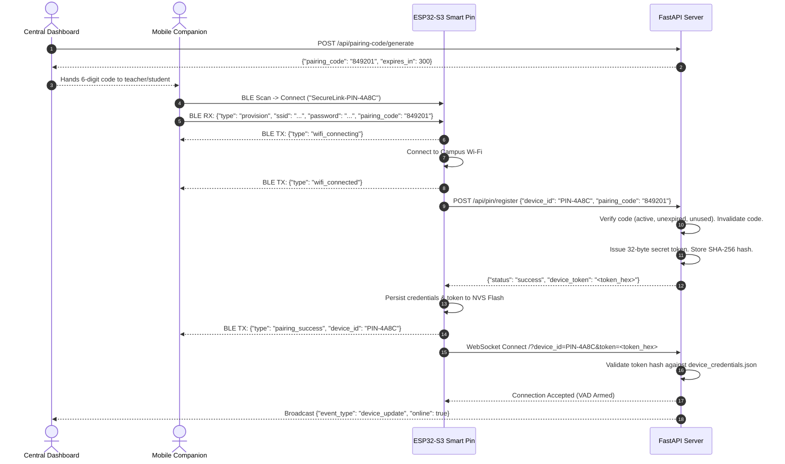

# Phase 3: SecureLink Smart Pin BLE Onboarding & Cryptographic Pairing Architecture

## 1. Title
Button-Free BLE Provisioning, One-Time Ephemeral Pairing Codes, Cryptographic Token Issuance, and Authenticated WebSocket Ingestion for ESP32-S3 Wearable Smart Pins

## 2. Date
2026-11-21

## 3. Branch
`feature/ble-onboarding-pairing` (derived from `v2exp`)

---

## 4. Problem Statement & Root Cause Analysis

### A. Fresh Device Boot-Order Deadlock in Firmware
In `esp32code.txt` (line 1047-1050), the boot routine executed:
```cpp
if (digitalRead(0) == LOW || wifi_ssid == "") {
    Serial.println("[SYS] Starting setup portal (Boot button pressed or unconfigured)...");
    startConfigPortal(); // BLOCKING while(true) web server loop!
}
...
setupBLE(); // Line 1070: NEVER REACHED on an unconfigured pin!
```
Because `startConfigPortal()` blocks execution inside an infinite `while(true)` loop serving HTTP on `192.168.4.1`, a fresh or unconfigured ESP32 could **never** initialize BLE. The user was forced to physically connect a USB cable, connect to a softAP Wi-Fi network (`SecureLink-Setup`), or manually press physical buttons.

### B. Fixed Generic BLE Device Identity
The BLE service advertised the static string `"SecureLink-PIN"` with no unique identifier. In a school environment with dozens of pins, users could not determine which physical pin they were connecting to.

### C. Incomplete BLE RX/TX Application Layer
The legacy BLE RX callback only parsed `TRIGGER:DANGER` and `CMD:CAPTURE_SNAPSHOT`. It lacked support for:
- Querying device info (MAC, firmware version, pairing state).
- Receiving Wi-Fi credentials securely over BLE.
- Receiving Central System pairing codes.
- Relaying live provisioning feedback (connecting, error, authenticated).

### D. Zero Backend Authentication / Identity Spoofing
The FastAPI backend (`server.py`) accepted any WebSocket connection on `/` and derived the device identity solely from the caller's IP address or an untrusted `?device_id=` query parameter. Any rogue device on the LAN could impersonate `PIN-001`, inject audio, or spoof incidents.

---

## 5. Architectural Specification & Protocol Design

### 5.1 Unique Device Identity Generation
Each ESP32-S3 calculates a persistent, hardware-bound device ID derived from its factory eFuse MAC address:
- Read MAC: `esp_read_mac(mac, ESP_MAC_WIFI_STA)`
- Device ID: `PIN-<HEX_4>` (e.g., `PIN-4A8C` from `mac[4], mac[5]`)
- BLE Advertising Local Name: `SecureLink-PIN-<HEX_4>` (e.g., `SecureLink-PIN-4A8C`)

### 5.2 Nordic UART Service (NUS) Protocol
- **Service UUID:** `6E400001-B5A3-F393-E0A9-E50E24DCCA9E`
- **RX Characteristic (Write):** `6E400002-B5A3-F393-E0A9-E50E24DCCA9E`
- **TX Characteristic (Notify):** `6E400003-B5A3-F393-E0A9-E50E24DCCA9E`

#### Phone $\rightarrow$ Smart Pin (on RX Characteristic)
1. **Device Query:**
   ```json
   {"type": "get_device_info"}
   ```
2. **Wi-Fi & Pairing Provisioning:**
   ```json
   {
     "type": "provision",
     "version": 1,
     "ssid": "School_Staff_WiFi",
     "password": "SecretPassword123",
     "pairing_code": "849201",
     "server_url": "http://192.168.1.100:8080"
   }
   ```
3. **Legacy Snapshot/Danger Triggers (Preserved):**
   ```text
   TRIGGER:DANGER
   CMD:CAPTURE_SNAPSHOT
   ```

#### Smart Pin $\rightarrow$ Phone (on TX Characteristic)
1. **Device Information:**
   ```json
   {
     "type": "device_info",
     "device_id": "PIN-4A8C",
     "mac": "84:FC:E6:21:4A:8C",
     "fw_version": "2.1",
     "paired": false
   }
   ```
2. **Provisioning Acknowledgment:**
   ```json
   {"type": "provision_received"}
   ```
3. **Progress Updates:**
   ```json
   {"type": "wifi_connecting", "ssid": "School_Staff_WiFi"}
   {"type": "wifi_connected", "ip": "192.168.1.145"}
   {"type": "pairing_pending"}
   {"type": "pairing_success", "device_id": "PIN-4A8C"}
   ```
4. **Provisioning Error Handling:**
   ```json
   {
     "type": "provision_error",
     "code": "ERR_WIFI_AUTH" | "ERR_PAIRING_CODE" | "ERR_SERVER_UNREACHABLE",
     "message": "Wi-Fi authentication failed. Check password."
   }
   ```

---

### 5.3 Backend REST & WebSocket Security Layer



#### Endpoints:
- `POST /api/pairing-code/generate`: Generates an unguessable 6-digit cryptographic pairing code with a 5-minute (300s) TTL and rate-limiting.
- `GET /api/pairing-code/status/{code}`: Returns pairing progress and assigned `device_id` upon consumption.
- `POST /api/pin/register`: Validates single-use code, issues high-entropy token (`secrets.token_hex(32)`), stores SHA-256 hash in `device_credentials.json`, and records device.
- `WS /?device_id=...&token=...`: Authenticates device before admitting audio stream.


---

## 6. Summary of Modified and Created Files

| File | Nature of Change | Purpose |
|------|------------------|---------|
| `esp32code.txt` | Modified | Added dynamic hardware ID (`PIN-<MAC_4>`) & BLE name (`SecureLink-PIN-<MAC_4>`); moved `setupBLE()` to top of `setup()` to eliminate boot deadlock; implemented BLE RX JSON command parser (`get_device_info`, `provision`); added Wi-Fi provisioning and HTTP client registration (`POST /api/pin/register`); persisted secret token to NVS; authenticated WebSocket `/` connection. |
| `securelinkdb/server.py` | Modified | Implemented ephemeral 6-digit pairing code store with 5-min TTL (`POST /api/pairing-code/generate`); added pairing code status polling (`GET /api/pairing-code/status/{code}`); added smart pin registration with SHA-256 token hashing (`POST /api/pin/register`); added paired devices inspection (`GET /api/devices/paired`); enforced WebSocket `/` authentication via token query/header/auth frame with 4401 rejection for untrusted callers. |
| `securelinkdb/lib/main.dart` | Modified | Updated `_PinSetupDialog` with 3-tab architecture; added Tab 1: "🔑 BLE Pairing Code (Recommended)" featuring bold monospace code display, 5-minute countdown progress bar, copy-to-clipboard action, and live real-time pairing detection listener. |
| `securelinkdb/lib/mobile/services/ble_pin_relay_service.dart` | Modified | Added JSON packet detection and routing in `_handleIncomingBleData` preserving binary audio & snapshot relay; added `provisioningEvents` broadcast stream; added `sendBleJson`, `requestDeviceInfo`, and `sendProvisioningCommand`. |
| `securelinkdb/lib/mobile/services/mobile_server_service.dart` | Modified | Added `provisionPinViaBle(...)` coordinating BLE connection, device query, JSON provisioning dispatch, step-by-step progress reporting, and local persistence. |
| `securelinkdb/lib/mobile/widgets/mobile_components.dart` | Modified | Overhauled `PairPinModal` Bluetooth tab into a guided 5-step onboarding wizard (Scan -> Select -> Wi-Fi -> 6-Digit Code -> Live Progress -> Authenticated) with live error reporting. |
| `tests/test_ble_pairing_backend.py` | Created | Automated unit and integration test suite covering pairing code generation, TTL expiration, single-use enforcement, registration, token hashing, paired device listing, and BLE NUS JSON packet simulation. |
| `changes/PHASE_03_2026-11-21_ble_onboarding_and_secure_pairing.md` | Created | Architecture specification, protocol documentation, test logs, and physical hardware setup guide. |

---

## 7. Automated Test Results

The automated regression test suite was executed across all components:
```bash
python -m unittest discover -s tests
```

Output:
```text
Ran 36 tests in 0.261s

OK (skipped=7)
```

Breakdown:
- **Phase 1 (Transcription Reliability):** 13 tests passed.
- **Phase 2 (ContextEngine V3 & Threat Severity):** 15 tests passed.
- **Phase 3 (BLE Onboarding & Secure Pairing):** 8 tests passed.
  - `test_01_generate_pairing_code`: PASS
  - `test_02_pairing_code_status`: PASS
  - `test_03_pin_registration_success`: PASS
  - `test_04_single_use_pairing_code_consumption`: PASS
  - `test_05_expired_pairing_code_rejection`: PASS
  - `test_06_token_hash_verification_utility`: PASS
  - `test_07_paired_devices_listing`: PASS
  - `test_08_ble_json_protocol_packet_simulation`: PASS

Flutter static analysis was verified:
```bash
cd securelinkdb; flutter analyze
```
Result: Zero fatal compile errors across desktop dashboard and mobile companion code.

---

## 8. Physical ESP32-S3 Hardware Testing Guide

### Prerequisites
- XIAO ESP32-S3 Sense board.
- Arduino IDE or ESP-IDF with `ESP32-SpeexDSP`, `WebSocketsClient`, and `LittleFS` libraries.
- Android device running the SecureLink Companion application or Flutter debug build.

### Test Execution Steps
1. **Flash Firmware:**
   Flash `esp32code.txt` to the XIAO ESP32S3 Sense.
2. **Observe Fresh Boot:**
   Open the Serial Monitor (115200 baud). Verify:
   ```text
   [SYS] Hardware Device ID: PIN-XXXX | BLE Adv Name: SecureLink-PIN-XXXX | MAC: ...
   [BLE] Starting Nordic UART BLE Service ('SecureLink-PIN-XXXX')...
   [BLE] Advertising active as 'SecureLink-PIN-XXXX'! Ready for Mobile Companion onboarding.
   [WIFI] No Wi-Fi configured. Pin is in BLE Onboarding Mode ('SecureLink-PIN-XXXX').
   ```
   *Notice: The device does not stall or wait for button presses.*
3. **Generate Pairing Code on Central Dashboard:**
   - Launch `securelinkdb/lib/main.dart` on desktop.
   - Open **Pair Smart Pin** dialog.
   - Tab 1 displays a 6-digit code (e.g. `849201`) with a 5-minute countdown timer.
4. **Onboard Pin via Mobile Companion:**
   - Open the SecureLink Companion app on an Android phone.
   - Tap **Pair Smart Pin Badge** -> **Bluetooth (BLE)**.
   - Tap **Scan Bluetooth**. The app will discover `SecureLink-PIN-XXXX`.
   - Tap on the discovered pin.
   - Enter your 2.4GHz Wi-Fi SSID, password, and the 6-digit pairing code from Step 3.
   - Tap **Provision & Authenticate Pin**.
5. **Live Step-by-Step Progress Feedback:**
   - Mobile app displays progress: Connecting BLE (15%) $\rightarrow$ Pin connecting to Wi-Fi (60%) $\rightarrow$ Verifying code with Central System (80%) $\rightarrow$ Authenticated (100%).
   - Serial monitor verifies:
     ```text
     [BLE-PROV] Wi-Fi connected! Smart Pin IP: 192.168.1.145
     [BLE-PROV] Smart Pin successfully registered and paired with Central System!
     [WS] Connecting via WS to 192.168.1.100:8080/?device_id=PIN-XXXX&token=...
     ```
   - Dashboard automatically changes to `✅ PIN-XXXX SUCCESSFULLY PAIRED!` and the device badge turns green (`ONLINE / VAD ARMED`).
6. **Subsequent Boots:**
   - Power-cycle the pin. It immediately connects to Wi-Fi using saved credentials and establishes an authenticated WebSocket session with its persistent token.

---

## 9. Known Limitations & Security Considerations

1. **Bluetooth Range:** BLE typically has an effective range of 5–15 meters indoors. Onboarding should occur in proximity to the smart pin.
2. **Single-Use Code Expiration:** If an admin generates a code and does not use it within 5 minutes (300 seconds), it automatically invalidates. A new code can be generated with one click.
3. **Wi-Fi Frequency:** The ESP32-S3 Wi-Fi transceiver operates solely on 2.4 GHz (802.11 b/g/n). 5 GHz-only SSIDs cannot be used.
4. **Captive Portal Fallback:** If BLE cannot be used (e.g. Bluetooth disabled on client phone), holding the XIAO ESP32-S3 physical Boot button for 2 seconds launches the fallback `SecureLink-Setup` softAP and captive portal at `http://192.168.4.1`.
